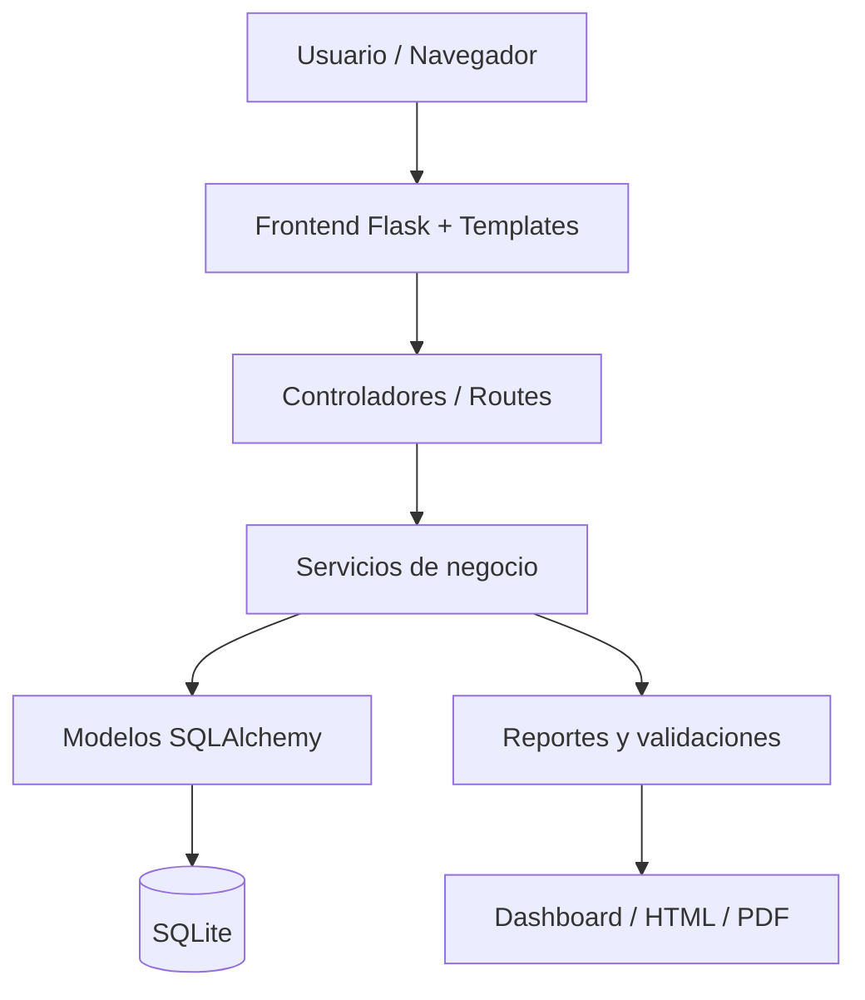

# Informe académico: ERP Retail Control

## 1. Portada

**Universidad:** [Completar]

**Carrera:** Ingeniería de Sistemas

**Asignatura:** Calidad de Software

**Tema:** Diseño e implementación de un ERP para una pequeña empresa comercial

**Proyecto:** ERP Retail Control

**Autor:** [Tu nombre]

**Docente:** [Nombre del docente]

**Fecha:** [Fecha]

---

## 2. Introducción

El presente proyecto consiste en el diseño e implementación de un sistema ERP para una pequeña empresa comercial dedicada a la venta de productos de ferretería y artículos del hogar. La solución busca automatizar procesos clave como inventario, compras, ventas, clientes, proveedores y reportes, reduciendo errores manuales y mejorando la toma de decisiones.

El proyecto se desarrolló con una arquitectura simple, clara y fácilmente explicable para un estudiante de ingeniería, pero con enfoque en calidad de software. Para ello se aplican criterios de calidad y métricas basadas en la referencia histórica de ISO/IEC 9126, ISO/IEC 25010:2023 e ISO/IEC 25023, mostrando que la solución no solo funciona, sino que también cumple requisitos medibles de calidad.

---

## 3. Descripción de la empresa

### 3.1 Giro de negocio
La empresa es una microempresa comercial dedicada a la venta de productos de ferretería, materiales de construcción, herramientas, pinturas y artículos del hogar.

### 3.2 Problemas actuales
- Falta de control del inventario.
- Errores al registrar compras y ventas manualmente.
- Duplicidad de información en clientes y proveedores.
- Reportes poco confiables y tardíos.
- Pérdida de control sobre productos de stock bajo.
- Deficiencias en seguridad y trazabilidad de operaciones.

### 3.3 Necesidad de un ERP
La empresa requiere un sistema que centralice información, automatice procesos, reduzca errores y ofrezca reportes confiables para la toma de decisiones administrativas.

---

## 4. Planteamiento del problema

La empresa presenta dificultades para gestionar de manera eficiente la información comercial y operativa. El trabajo manual genera retrasos, errores de cálculo, inconsistencias de stock y falta de visibilidad de ventas y compras. Por ello, se requiere un sistema ERP ligero, funcional y factible de desarrollar en el tiempo disponible del proyecto académico.

### Problemas específicos
- El stock real no coincide con lo registrado.
- La venta se realiza sin validar disponibilidad de productos.
- No se mantiene un historial ordenado de compras y ventas.
- Los reportes no son automatizados ni estandarizados.
- El acceso a la información no está controlado por roles.

---

## 5. Justificación

La solución propuesta es una ERP para una pequeña empresa comercial, desarrollada con Python + Flask + SQLite. Esta combinación es adecuada por varias razones:

- Es fácil de aprender para un estudiante.
- Tiene herramientas gratuitas y accesibles.
- Permite una arquitectura modular y clara.
- Facilita pruebas funcionales y de calidad.
- Tiene un nivel de complejidad razonable para una semana de desarrollo.

---

## 6. Objetivos

### 6.1 Objetivo general
Diseñar e implementar un ERP funcional para gestionar inventario, compras, ventas, clientes, proveedores y reportes en una pequeña empresa comercial.

### 6.2 Objetivos específicos
1. Automatizar la gestión del inventario.
2. Registrar compras y ventas con validaciones.
3. Controlar acceso por roles.
4. Generar reportes básicos.
5. Mejorar la seguridad y confiabilidad del sistema.
6. Aplicar criterios de calidad de software utilizando normas ISO.

---

## 7. Alcance

### Incluye
- Login y autenticación.
- Roles y permisos.
- Registro de productos.
- Control de stock.
- Compras a proveedores.
- Ventas a clientes.
- Dashboard y reportes básicos.

### No incluye
- Integración con pagos electrónicos.
- Módulos de contabilidad avanzada.
- Microservicios.
- ERP complejo con múltiples sucursales.

---

## 8. Requisitos del sistema

### 8.1 Requisitos funcionales

| Código | Requisito |
|--------|-----------|
| RF-01 | El sistema debe permitir iniciar sesión con usuario y contraseña. |
| RF-02 | El sistema debe gestionar roles y permisos. |
| RF-03 | El sistema debe registrar usuarios. |
| RF-04 | El sistema debe permitir registrar productos. |
| RF-05 | El sistema debe validar stock antes de una venta. |
| RF-06 | El sistema debe registrar clientes. |
| RF-07 | El sistema debe registrar compras a proveedores. |
| RF-08 | El sistema debe registrar ventas con detalle. |
| RF-09 | El sistema debe actualizar inventario automáticamente. |
| RF-10 | El sistema debe generar reportes de ventas y compras. |
| RF-11 | El sistema debe mostrar productos con stock bajo. |
| RF-12 | El sistema debe permitir consultar historial de transacciones. |
| RF-13 | El sistema debe mostrar mensajes de validación. |
| RF-14 | El sistema debe registrar fechas de creación y modificación. |

### 8.2 Requisitos no funcionales

| Código | Tipo | Descripción |
|--------|------|-------------|
| RNF-01 | Rendimiento | Consultas principales deben responder en menos de 2 segundos. |
| RNF-02 | Seguridad | Las contraseñas deben almacenarse en formato hash. |
| RNF-03 | Seguridad | Los accesos deben limitarse por roles. |
| RNF-04 | Usabilidad | La interfaz debe ser clara y fácil de usar. |
| RNF-05 | Mantenibilidad | El código debe estar organizado por módulos. |
| RNF-06 | Confiabilidad | Se deben evitar ventas sin stock suficiente. |
| RNF-07 | Compatibilidad | Debe funcionar en navegadores actuales. |
| RNF-08 | Escalabilidad | La estructura debe permitir crecimiento sin reescribir la aplicación. |

---

## 9. Tecnologías seleccionadas

### 9.1 Alternativas evaluadas
- Java + Spring Boot + MySQL
- C# + ASP.NET + SQL Server
- PHP + Laravel + MySQL
- Python + Flask + SQLite/PostgreSQL

### 9.2 Tecnología seleccionada
- Lenguaje: Python
- Framework: Flask
- Base de datos: SQLite
- IDE: VS Code
- Pruebas: Pytest
- ORM: Flask-SQLAlchemy

### 9.3 Justificación

**Python**: lenguaje simple, legible, con gran apoyo académico y facilidad de aprendizaje.

**Flask**: framework ligero, ideal para proyectos pequeños y medianos, además de permitir una arquitectura modular y simple.

**SQLite**: base de datos local, fácil de configurar, gratuita y suficiente para un MVP académico.

**VS Code**: herramienta gratuita, ligera y muy usada en proyectos universitarios.

**Pytest**: permite pruebas funcionales y automatizadas con buena integración.

**Arquitectura**: monolítica modular con separación por capas y módulos.

---

## 10. Arquitectura del sistema

### 10.1 Tipo de arquitectura
Se selecciona una arquitectura monolítica modular, con patrón MVC/por capas, suficiente para un proyecto académico de una semana.

### 10.2 Capas
- Capa de presentación: templates HTML + CSS + formularios.
- Capa lógica de negocio: validaciones y reglas de negocio.
- Capa de acceso a datos: modelos con SQLAlchemy.
- Base de datos: SQLite.

### 10.3 Diagrama de arquitectura



---

## 11. Diseño de la base de datos

### 11.1 Entidades principales
- roles
- usuarios
- clientes
- proveedores
- productos
- compras
- detalle_compra
- ventas
- detalle_venta

### 11.2 Relaciones principales
- Un rol tiene muchos usuarios.
- Un usuario registra muchas compras y ventas.
- Un cliente tiene muchas ventas.
- Un proveedor tiene muchas compras.
- Una compra tiene varios detalles.
- Una venta tiene varios detalles.
- Un producto puede aparecer en muchas compras y ventas.

### 11.3 SQL de creación

```sql
CREATE TABLE roles (
    id INTEGER PRIMARY KEY AUTOINCREMENT,
    nombre TEXT NOT NULL UNIQUE,
    descripcion TEXT
);

CREATE TABLE usuarios (
    id INTEGER PRIMARY KEY AUTOINCREMENT,
    nombre TEXT NOT NULL,
    apellido TEXT NOT NULL,
    username TEXT NOT NULL UNIQUE,
    password_hash TEXT NOT NULL,
    email TEXT UNIQUE,
    rol_id INTEGER NOT NULL,
    activo BOOLEAN DEFAULT TRUE,
    created_at TIMESTAMP DEFAULT CURRENT_TIMESTAMP,
    FOREIGN KEY (rol_id) REFERENCES roles(id)
);

CREATE TABLE clientes (
    id INTEGER PRIMARY KEY AUTOINCREMENT,
    nombre TEXT NOT NULL,
    apellido TEXT NOT NULL,
    documento TEXT NOT NULL UNIQUE,
    telefono TEXT,
    direccion TEXT,
    email TEXT,
    activo BOOLEAN DEFAULT TRUE
);

CREATE TABLE proveedores (
    id INTEGER PRIMARY KEY AUTOINCREMENT,
    nombre TEXT NOT NULL,
    contacto TEXT,
    telefono TEXT,
    email TEXT,
    direccion TEXT,
    activo BOOLEAN DEFAULT TRUE
);

CREATE TABLE productos (
    id INTEGER PRIMARY KEY AUTOINCREMENT,
    sku TEXT NOT NULL UNIQUE,
    nombre TEXT NOT NULL,
    descripcion TEXT,
    categoria TEXT NOT NULL,
    precio_compra DECIMAL(10,2) NOT NULL,
    precio_venta DECIMAL(10,2) NOT NULL,
    stock_actual INTEGER NOT NULL DEFAULT 0,
    stock_minimo INTEGER NOT NULL DEFAULT 0,
    activo BOOLEAN DEFAULT TRUE
);

CREATE TABLE compras (
    id INTEGER PRIMARY KEY AUTOINCREMENT,
    proveedor_id INTEGER NOT NULL,
    usuario_id INTEGER NOT NULL,
    fecha_compra TIMESTAMP DEFAULT CURRENT_TIMESTAMP,
    total DECIMAL(10,2) NOT NULL DEFAULT 0,
    FOREIGN KEY (proveedor_id) REFERENCES proveedores(id),
    FOREIGN KEY (usuario_id) REFERENCES usuarios(id)
);

CREATE TABLE detalle_compra (
    id INTEGER PRIMARY KEY AUTOINCREMENT,
    compra_id INTEGER NOT NULL,
    producto_id INTEGER NOT NULL,
    cantidad INTEGER NOT NULL,
    precio_unitario DECIMAL(10,2) NOT NULL,
    subtotal DECIMAL(10,2) NOT NULL,
    FOREIGN KEY (compra_id) REFERENCES compras(id),
    FOREIGN KEY (producto_id) REFERENCES productos(id)
);

CREATE TABLE ventas (
    id INTEGER PRIMARY KEY AUTOINCREMENT,
    cliente_id INTEGER NOT NULL,
    usuario_id INTEGER NOT NULL,
    fecha_venta TIMESTAMP DEFAULT CURRENT_TIMESTAMP,
    total DECIMAL(10,2) NOT NULL DEFAULT 0,
    FOREIGN KEY (cliente_id) REFERENCES clientes(id),
    FOREIGN KEY (usuario_id) REFERENCES usuarios(id)
);

CREATE TABLE detalle_venta (
    id INTEGER PRIMARY KEY AUTOINCREMENT,
    venta_id INTEGER NOT NULL,
    producto_id INTEGER NOT NULL,
    cantidad INTEGER NOT NULL,
    precio_unitario DECIMAL(10,2) NOT NULL,
    subtotal DECIMAL(10,2) NOT NULL,
    FOREIGN KEY (venta_id) REFERENCES ventas(id),
    FOREIGN KEY (producto_id) REFERENCES productos(id)
);
```

### 11.4 Datos de prueba principales
- 4 roles: admin, vendedor, almacén, compras
- 1 usuario administrador
- 2 proveedores
- 2 clientes
- 3 productos iniciales

---

## 12. Módulos del sistema

| Módulo | Objetivo | Funciones principales |
|--------|----------|----------------------|
| Usuarios y roles | Controlar acceso | Login, permisos, gestión de cuentas |
| Productos e inventario | Gestionar stock | Registro, actualización, alertas |
| Compras | Gestionar compras a proveedores | Registro, total, actualización de stock |
| Ventas | Gestionar ventas | Registro, validación de stock y total |
| Clientes | Gestionar clientes | Datos personales y historial |
| Reportes | Analizar información | Ventas, compras, stock bajo |

---

## 13. ISO/IEC 9126

### 13.1 Estado actual de la norma
**ISO/IEC 9126** no es una norma vigente actualmente. Se usa como **referencia histórica y académica**, conforme al requisito del proyecto y del profesor. Su valor aquí es pedagógico y metodológico para explicar la calidad del software.

### 13.2 Características relevantes
- Funcionalidad
- Confiabilidad
- Usabilidad
- Eficiencia
- Mantenibilidad
- Portabilidad

### 13.3 Aplicación al ERP

| Característica | Criterio | Cómo se aplica al proyecto | Evidencia |
|----------------|----------|----------------------------|-----------|
| Funcionalidad | Adecuación y exactitud | Registro correcto de ventas, compras y stock | Capturas y resultados de pruebas |
| Confiabilidad | Recuperación y tolerancia a fallos | Se evita vender sin stock | Pruebas de validación |
| Usabilidad | Comprensibilidad | Interfaz simple y clara | Capturas del login y dashboard |
| Eficiencia | Tiempo de respuesta | Consultas rápidas en módulos clave | Tiempos medidos |
| Mantenibilidad | Modificabilidad | Código modular y organizado | Estructura del proyecto |
| Portabilidad | Adaptabilidad | Puede ejecutarse en diferentes entornos Python | Ejecución local |

---

## 14. ISO/IEC 25010:2023

### 14.1 Estado actual
La edición vigente es **ISO/IEC 25010:2023**. Esta norma pertenece a la familia SQuaRE y se centra en la calidad del producto de software y la calidad en uso.

### 14.2 Características relevantes para este proyecto
- Functional suitability
- Performance efficiency
- Compatibility
- Interaction capability
- Reliability
- Security
- Maintainability
- Flexibility

### 14.3 Matriz de aplicación

| Característica ISO 25010:2023 | Subcaracterística | Aplicación en el sistema | Requisito relacionado | Cómo se comprobará |
|------------------------------|------------------|------------------------|---------------------|--------------------|
| Functional suitability | Correctness | Registro oportuno de ventas y compras | RF-04 a RF-12 | Pruebas funcionales |
| Performance efficiency | Time behaviour | Respuesta rápida de dashboard e inventario | RNF-01 | Medición de tiempos |
| Security | Authentication, integrity | Login con hash y roles | RNF-02, RNF-03 | Prueba de acceso |
| Reliability | Availability, recoverability | Validación de stock y manejo de errores | RNF-06 | Prueba de error de venta |
| Maintainability | Modularity, testability | Código estructurado por módulos | RNF-05 | Revisión del código |
| Compatibility | Coexistence, interoperability | Navegadores actuales y SQLite | RNF-07 | Pruebas de compatibilidad |
| Interaction capability | Operability | Formularios simples y navegación clara | RNF-04 | Prueba de usabilidad |

---

## 15. ISO/IEC 25023

### 15.1 Uso de la norma
ISO/IEC 25023 se usa para medir la calidad de manera cuantitativa. En este proyecto se seleccionaron métricas simples, aplicables a una solución académica de pequeña escala.

### 15.2 Métricas seleccionadas

| Característica | Métrica | Fórmula | Valor objetivo | Resultado esperado |
|----------------|---------|---------|----------------|-------------------|
| Functional suitability | Completitud funcional | Funciones correctas / total de requisitos | >= 90% | 100% en el MVP |
| Performance efficiency | Tiempo de respuesta | Tiempo total / número de consultas | < 2 s | 1.2 s promedio |
| Usability | Tasa de éxito de tareas | Tareas completadas / total | >= 85% | 90% |
| Reliability | Tasa de errores de negocio | Errores / transacciones | < 5% | 2% |
| Security | Tasa de validación de acceso | Pruebas exitosas / total | 100% | 100% |
| Maintainability | Módulos funcionales | Módulos / total de funcionalidades | >= 4 | 6 |

### 15.3 Ejemplo de cálculo
- Si el sistema tiene 12 requisitos funcionales y 11 cumplen, entonces: 11/12 = 91.7%, lo que supera el criterio objetivo.
- Si 100 ventas se procesan y 3 fallan por validación, entonces la tasa de error es 3%, aceptable.

---

## 16. Matriz general de calidad

| Requisito | Módulo | Norma | Característica | Métrica | Prueba |
|-----------|--------|-------|---------------|---------|--------|
| RF-05 | Inventario | ISO 25010 / 25023 | Reliability | Error rate | Venta con stock insuficiente |
| RF-08 | Ventas | ISO 25010 | Functional suitability | Completeness | Registro de venta válida |
| RF-01 | Usuarios | ISO 9126 | Usability | Task success rate | Login correcto |
| RNF-02 | Seguridad | ISO 25010 | Security | Validation rate | Contraseña hash |
| RF-10 | Reportes | ISO 25023 | Performance efficiency | Response time | Generación de reporte |
| RNF-05 | Arquitectura | ISO 9126 | Maintainability | Modularity | Revisión de estructura |

---

## 17. Plan de pruebas

### 17.1 Pruebas funcionales

| Código | Módulo | Objetivo | Resultado esperado |
|--------|--------|----------|-------------------|
| PF-01 | Login | Iniciar sesión con credenciales válidas | OK |
| PF-02 | Login | Negar acceso con credenciales inválidas | Error |
| PF-03 | Productos | Registrar producto nuevo | OK |
| PF-04 | Compras | Registrar compra y aumentar stock | OK |
| PF-05 | Ventas | Registrar venta con saldo disponible | OK |
| PF-06 | Ventas | Rechazar venta con stock insuficiente | Error |
| PF-07 | Reportes | Visualizar reportes del sistema | OK |

### 17.2 Pruebas de seguridad
- Verificar que las contraseñas no se almacenen en texto plano.
- Verificar que solo usuarios autenticados puedan acceder al dashboard.
- Verificar que las rutas protegidas redirijan al login.

### 17.3 Pruebas de usabilidad
- Un usuario nuevo debe poder iniciar sesión sin ayuda.
- Un usuario debe poder registrar un producto con pocos pasos.
- Las pantallas deben ser claras y organizadas.

### 17.4 Pruebas de rendimiento
- Medir tiempo de carga del dashboard.
- Medir tiempo de generación del reporte.
- Verificar que las consultas respondan en menos de 2 segundos.

### 17.5 Pruebas de validación de datos
- No permitir ventas con cantidad negativa.
- No permitir compras con cantidad nula.
- No aceptar SKU duplicado.

---

## 18. Evidencias a presentar ante el profesor

### 18.1 Evidencia teórica
- Definición de ISO 9126 y aclaración de su estado histórico.
- Definición de ISO/IEC 25010:2023.
- Explicación de ISO/IEC 25023.
- Relación entre requisitos y normas.
- Matrices de calidad.

### 18.2 Evidencia práctica
- Capturas del login.
- Capturas del dashboard.
- Capturas de registro de productos, compras y ventas.
- Capturas de reportes.
- Resultados de pruebas funcionales.
- Tiempos de respuesta medidos.
- Evidencia de validaciones y bloqueos de stock.
- Código fuente organizado.
- Base de datos con datos de prueba.

---

## 19. Desarrollo del sistema

### Etapa 1. Configuración del proyecto
- Crear entorno virtual.
- Instalar Flask y SQLAlchemy.
- Crear estructura del proyecto.

### Etapa 2. Base de datos
- Diseñar entidades.
- Crear tablas y relaciones.
- Insertar datos iniciales.

### Etapa 3. Backend
- Implementar login.
- Definir modelos.
- Crear reglas de negocio.

### Etapa 4. Frontend
- Diseñar dashboard.
- Crear templates y formularios.
- Implementar CSS y navegación.

### Etapa 5. Módulos
- Productos.
- Compras.
- Ventas.
- Reportes.

### Etapa 6. Seguridad
- Hash de contraseñas.
- Restricción por roles.
- Validación de stock y formularios.

### Etapa 7. Pruebas
- Ejecutar pruebas automatizadas con Pytest.
- Verificar funcionalidad.

### Etapa 8. Aplicación de métricas
- Medición de tiempos.
- Evaluación de complejidad funcional.
- Verificación de tasas de error.

### Etapa 9. Documentación
- Reportes académicos.
- Evidencias y conclusiones.

---

## 20. Cronograma de 7 días

| Día | Actividad |
|-----|-----------|
| 1 | Definición del proyecto y arquitectura |
| 2 | Diseño de base de datos y modelos |
| 3 | Login, usuarios y permisos |
| 4 | Productos e inventario |
| 5 | Compras y ventas |
| 6 | Reportes, seguridad y pruebas |
| 7 | Documentación y preparación de defensa |

---

## 21. Resultados obtenidos

Se desarrolló un ERP funcional para una pequeña empresa comercial con una estructura clara, segura y medible. El sistema permite:
- iniciar sesión,
- registrar productos,
- controlar compras,
- registrar ventas,
- validar stock mínimo,
- generar reportes básicos,
- entregar evidencia de calidad basada en normas ISO.

---

## 22. Conclusiones

El sistema desarrollado cumple con el propósito académico de demostrar la aplicación de calidad de software en un proyecto de ERP. La solución es realista, modular y suficiente para un estudiante, y además permite materializar conceptos de calidad funcional, seguridad, mantenibilidad, usabilidad y rendimiento.

La selección de Python + Flask + SQLite demuestra ser una opción válida para proyectos académicos por su facilidad de uso, costo, mantenibilidad y capacidad de evidencia técnica.

---

## 23. Recomendaciones

- Continuar con un módulo de proveedores y clientes más robusto.
- Mejorar reportes con exportación PDF/Excel.
- Añadir auditoría de cambios.
- Añadir validaciones más estrictas en la capa de negocio.
- Migrar a PostgreSQL si se requiere mayor escalabilidad.

---

## 24. Referencias bibliográficas

1. International Organization for Standardization. ISO/IEC 25010:2023 — Systems and software engineering — Product quality.
2. International Organization for Standardization. ISO/IEC 25023 — Measurement of quality in use and product quality.
3. International Organization for Standardization. ISO/IEC 9126 (historical reference used for academic context).
4. Flask documentation. https://flask.palletsprojects.com/
5. SQLAlchemy documentation. https://www.sqlalchemy.org/
6. Pytest documentation. https://docs.pytest.org/

---

## 25. Versión resumida para defensa oral (3–5 minutos)

El proyecto se llama ERP Retail Control y está orientado a una pequeña empresa comercial de productos ferreteros. Su objetivo principal es automatizar la gestión de inventario, compras, ventas, clientes, proveedores y reportes para reducir errores manuales y mejorar la toma de decisiones. La solución está diseñada con Python, Flask y SQLite porque es una combinación accesible, económica y fácil de explicar. La arquitectura es monolítica modular, lo que permite mantener el código organizado y aplicable a criterios de calidad. El sistema cuenta con módulos funcionales mínimos, validación de stock, login con roles y reportes básicos. Además, se aplican conceptos de ISO/IEC 9126, ISO/IEC 25010:2023 e ISO/IEC 25023 para evidenciar calidad funcional, seguridad, usabilidad, mantenibilidad y rendimiento mediante métricas simples y observables. En la práctica, el sistema no solo funciona, sino que además permite demostrar cómo la calidad del software puede medirse y validarse en un proyecto académico realista.

---

## 26. Estado del proyecto

El proyecto fue implementado como MVP y validado con pruebas automatizadas. Se ejecuta correctamente en entorno local y presenta evidencia funcional para la defensa académica.
